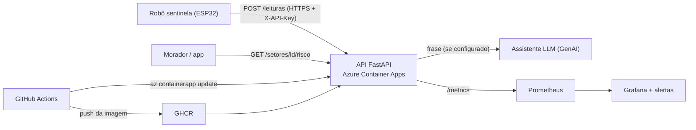
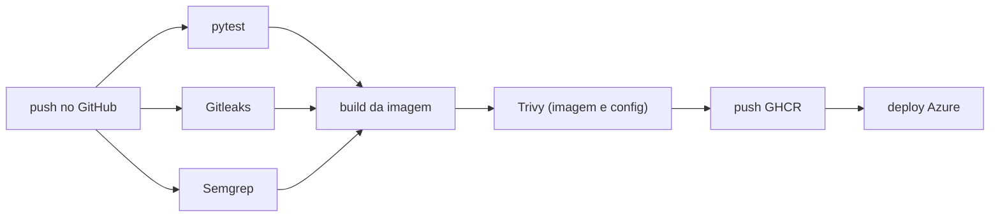

# Arquitetura, responsabilidade compartilhada, dados pessoais e custo

## Diagrama

## Pipeline DevSecOps

## Matriz de responsabilidade compartilhada

| Camada | Provedor (Azure / GitHub) | Nossa equipe |
|---|---|---|
| Datacenter, hardware, rede física | X | |
| Plataforma Container Apps (host, patch do SO do nó, TLS do domínio padrão) | X | |
| Runner do GitHub Actions | X | |
| Código da API e dependências | | X |
| Imagem de container (base, usuário não root, scan Trivy) | | X |
| Segredos (GitHub Secrets, Secret do Container App, `.tfvars` fora do repo) | | X |
| Configuração de rede e exposição (apenas HTTPS, sem porta de administração) | | X |
| Monitoramento, alertas e resposta a incidentes | | X |
| Dados enviados pelos sensores | | X |

## Onde ficam os dados pessoais

A versão atual da API não possui cadastro de moradores nem solicita diretamente nome, CPF, telefone ou endereço.

A aplicação recebe:
- `setor_id`: identificação do setor monitorado;
- `umidade_pct`: percentual de umidade do solo;
- `nivel`: classificação da situação;
- `recebido_em`: horário de recebimento da leitura.

As últimas leituras ficam armazenadas em memória na variável `ULTIMA`, sem persistência em banco de dados nesta versão do MVP.

O identificador do setor não deve permitir a identificação pública de moradores. Caso seja associado a uma pessoa identificável em versões futuras, deverão ser adotadas medidas adicionais de proteção e controle de acesso.

As credenciais são configuradas por variáveis de ambiente, e o recebimento das leituras exige chave de API.

Os registros de infraestrutura e monitoramento devem possuir acesso restrito e políticas de retenção adequadas, respeitando os princípios de segurança, necessidade e prevenção da LGPD.

O Encosta Viva é um MVP acadêmico e não substitui os procedimentos oficiais da Defesa Civil.

## Estimativa de custo mensal

A infraestrutura utiliza recursos da Microsoft Azure na região `brazilsouth`.

| Recurso | Configuração | Observação |
|---|---|---|
| Azure Container Apps | 0,25 vCPU, 0,5 GiB, mínimo de 1 réplica | Plano Consumption |
| Log Analytics | SKU PerGB2018 | Cobrança conforme ingestão |
| Retenção de logs | 30 dias | Configuração do workspace |
| Limite diário de ingestão | Sem limite configurado | `dailyQuotaGb = -1` |
| GitHub Actions e GHCR | Repositório público | Utilização conforme limites gratuitos aplicáveis |

### Consumo observado

Na consulta de utilização do Log Analytics, referente aos últimos 30 dias, foi identificado:

- Dados faturáveis ingeridos: **0,0001 GB** (aproximadamente 0,1 MB).
- Retenção configurada: **30 dias**.
- SKU: **PerGB2018**.

O volume observado de ingestão é muito baixo. Entretanto, o custo total mensal depende também da execução do Azure Container Apps, do consumo de recursos, do tráfego e dos preços vigentes na região.

Os valores financeiros devem ser complementados com a estimativa da calculadora oficial da Azure: https://azure.microsoft.com/pricing/calculator/