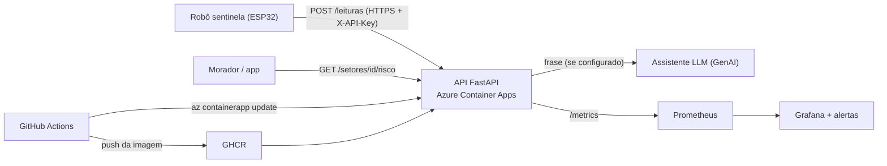
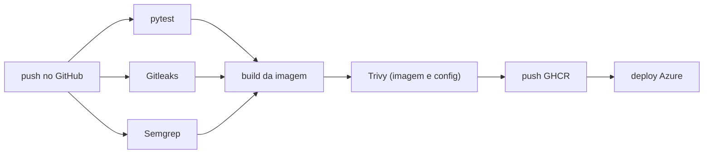

# Arquitetura, responsabilidade compartilhada, dados pessoais e custo

## Diagrama

## Pipeline DevSecOps

## Matriz de responsabilidade compartilhada

| Camada | Provedor (Azure / GitHub) | Nossa equipe |
|---|---|---|
| Datacenter, hardware, rede física | X | |
| Plataforma Container Apps (host, patch do SO do nó, TLS do domínio padrão) | X | |
| Runner do GitHub Actions | X | |
| Código da API e dependências | | X |
| Imagem de container (base, usuário não root, scan Trivy) | | X |
| Segredos (GitHub Secrets, Secret do Container App, `.tfvars` fora do repo) | | X |
| Configuração de rede e exposição (apenas HTTPS, sem porta de administração) | | X |
| Monitoramento, alertas e resposta a incidentes | | X |
| Dados enviados pelos sensores | | X |

## Onde ficam os dados pessoais

Nesta versão a API **não coleta nem guarda dado pessoal**: apenas `setor_id`, `umidade_pct` e `nivel`, em memória.
Se o grupo adicionar cadastro de moradores, ele deve ficar só no banco (Postgres), com identificador em hash
(SHA-256 + salt), sem nome, telefone ou endereço em claro, e fotos sem EXIF.

## Estimativa de custo mensal

Preencher com a calculadora oficial (https://azure.microsoft.com/pricing/calculator/) e anexar o print no PDF:

| Recurso | Configuração usada | Custo estimado |
|---|---|---|
| Azure Container Apps | 0,25 vCPU, 0,5 GiB, 1 réplica 24x7 | (preencher) |
| Log Analytics | baixa ingestão, retenção de 30 dias | (preencher) |
| GHCR, GitHub Actions | repositório público | sem custo |
| **Total/mês** | | (preencher) |
